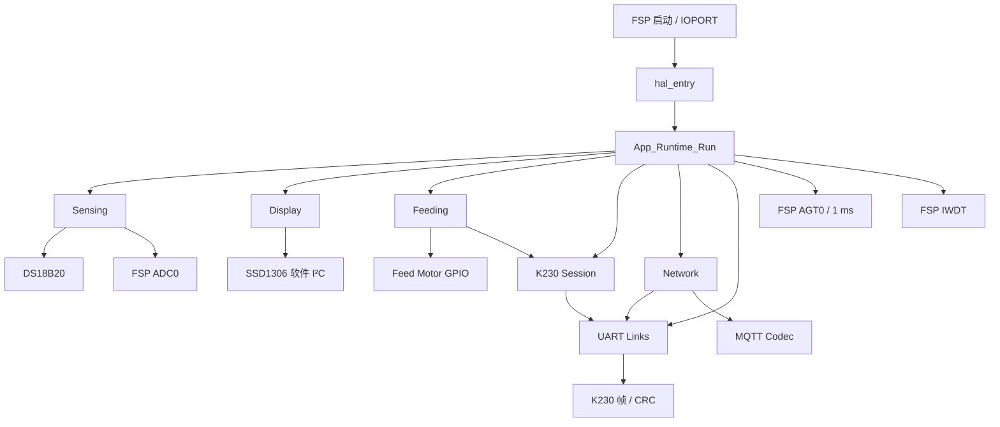

# PondSense RA4M2 项目架构说明

## 1. 项目简介与范围

本仓库的当前固件面向配置为 `R7FA4M2AD3CFL` 的 RA4M2。RA4M2 负责采样、显示、ESP-01S 联网、K230 文本结果接收及投喂电机控制；K230 视觉推理程序、模型、图片存储与上传实现不在本仓库内。固件使用 Renesas FSP 6.6.0、RASC、Keil MDK 和无 RTOS 主循环。

本文依据 `configuration.xml`、`pondsence_RA4M2.uvprojx`、`src/` 及对应 FSP 生成文件描述**当前源码结构**。目录名 `pondsence_RA4M2` 是既有工程路径，产品显示字符串为 `PondSence`。第三方接线、烧录与运行前仍须核对实际板卡和模块。

## 2. 工程目录

```text
.
├── README.md                         # 获取、配置与验证入口
├── 项目架构说明.md                    # 本文
├── pondsence_RA4M2/
│   ├── configuration.xml             # RASC 上游配置
│   ├── pondsence_RA4M2.uvprojx        # Keil Target_1
│   ├── buildinfo.gpdsc                # RASC 管理的组件描述
│   ├── ra/                            # FSP、CMSIS 与启动内容
│   ├── ra_cfg/、ra_gen/、via/          # 生成配置、初始化和编译参数
│   ├── src/
│   │   ├── hal_entry.c                # FSP 入口转交应用
│   │   ├── hal_warmstart.c            # 启动期间打开 IOPORT
│   │   ├── app/                       # 调度、采样、显示、投喂、K230 会话、网络
│   │   ├── modules/                   # DS18B20、电机、OLED、双 UART 链路
│   │   └── protocol/                  # K230 与 MQTT 编解码
│   └── script/fsp.scat                # 链接区域
├── tools/F407_SPI_Capture/            # 历史诊断工具，非 RA4M2 固件
└── st7735s_backup_2026-10-17/        # 已撤回显示方案的归档
```

`Objects/`、`Listings/`、Keil 个人选项和 `src/app/network.local.h` 均为本机内容，不随 Git 发布。

## 3. 分层职责

| 层 | 主要文件 | 职责与边界 |
| --- | --- | --- |
| RASC/FSP | `configuration.xml`、`ra/`、`ra_cfg/`、`ra_gen/` | 器件、时钟、引脚、外设实例、启动与底层驱动；生成代码不承载业务规则 |
| 应用入口 | `src/hal_entry.c`、`src/app/runtime.c` | 初始化顺序、AGT0 毫秒时基、IWDT 刷新和主循环调度 |
| Application | `src/app/sensing.c`、`display.c`、`feeding.c`、`k230_session.c`、`network.c` | 采样状态机、界面、批次决策、视觉会话、ESP AT/TCP/MQTT 状态机 |
| 设备模块 | `src/modules/ds18b20/`、`feed_motor/`、`ssd1306/`、`uart_links/` | 与端口、时序或 UART 驱动直接相关的行为；不决定摄食等级含义 |
| 协议 | `src/protocol/k230/`、`mqtt/` | K230 帧/CRC 与 MQTT 报文边界、报文构建；不操作引脚或电机 |
| 本地配置入口 | `src/app/network_config.h` | 读取被忽略的 `network.local.h`；无配置时提供空默认值 |

当前 `network.c` 同时管理 ESP AT、TCP 和 MQTT 会话状态；MQTT 报文构建与帧边界解析已独立到 `protocol/mqtt`。这反映现有源码，不套用其他项目的目录层次。

## 4. 模块关系



`K230 Session` 处理事件号、ACK、RESULT、UPLOAD 状态及 20 秒结果超时；`Feeding` 只消费与本次观察事件号匹配的结果。网络下行只写入最近消息缓存，不进入投喂控制路径。

## 5. 启动、中断与主循环

FSP 启动流程在 `R_BSP_WarmStart(BSP_WARM_START_POST_C)` 打开 IOPORT，随后 `hal_entry()` 调用 `App_Runtime_Run()`。应用初始化依次将两路电机输出拉低、打开并刷新 IWDT、打开并启动 AGT0、初始化 OLED、打开两路 UART、注册 K230 解析回调、初始化投喂状态与联网状态。

主循环的固定顺序为：

```text
App_Sensing_Process
→ App_Network_Process
→ Uart_Links_Process
→ App_Feeding_Process
→ App_K230_Process
→ App_Display_Process
→ 条件满足时刷新 IWDT
→ __WFI 等待中断
```

AGT0 以 1 ms 周期更新时基，并在回调内检查单次电机运行期限。SCI0/SCI2 回调只收集字节、记录 UART 错误和完成发送标志；AT、MQTT、K230 帧解析及业务决策都在主循环中执行。UART 接收环形缓冲区由 ISR 写入、主循环读出。

## 6. 投喂与 K230 数据流程

### 6.1 批次决策

K4（P013）按下并去抖后启动首批 **1 次抽拉**。每次抽拉设计时长为 **17 秒**，由 AGT0 回调检查停机；同批两次抽拉之间间隔 1 秒。在一批的最后一次抽拉开始约 8 秒后，RA 向 K230 发出 OBS 请求，等待与事件号对应的 RESULT：

| RESULT | 当前批结束后的动作 |
| --- | --- |
| `valid=1, level=0` | 进入完成状态；再次按 K4 不重启，需复位 |
| `valid=1, level=1` | 再执行 1 次完整抽拉，然后重新识别 |
| `valid=1, level=2` | 再执行 2 次完整抽拉，然后重新识别 |
| 格式正确的 `valid=0, level=0` | 停机并进入故障锁定 |
| NACK、发送失败、20 秒内无 RESULT | 停机并进入故障锁定 |

字段或 CRC 错误的帧会在协议层丢弃；若后续没有有效 RESULT，投喂层按超时故障处理。17 秒是**单次完整抽拉**的时长；等级 2 后的两次抽拉是预期业务行为。固件尚无整轮累计抽拉次数或出料量上限，不能用“每批最多 2 次”替代整轮上限。

### 6.2 K230 文本协议

SCI2 使用 115200、8N1。RA 发出的 OBS、K230 返回的 ACK/NACK/RESULT/UPLOAD 都采用以 `$` 开头、`*` 后跟 CRC-8/ATM 校验、以换行结束的文本帧。RESULT 载荷字段为 `PS1,RESULT,<event_id>,<valid>,<level>,<upload_status>`。RA 按事件号过滤过期或重复回复；`valid=0, level=0` 可以被协议层接收，并由投喂层判为无效结果故障。

RA 只接收文本和上传状态，不接收、存储或转发 K230 图片。K230 发送端软件不在本仓库中；协议修改需要双端同步。

### 6.3 电机与异常停机

`feed_motor.c` 控制 P500/P402 两路输入。RASC 将它们配置为默认低电平，应用初始化再次写低；每次启动最多允许 17 秒。运行中若主循环无法继续，AGT0 中断仍负责到期停机；IWDT 自动启动，主循环约每秒刷新一次。HardFault、MemManage、BusFault、UsageFault 处理入口直接写端口清零寄存器，随后停留等待复位。

这些机制是**软件与端口寄存器层面的保护**。异常瞬间实际引脚电压和带负载的机械停止效果须单独测量，不能由源码或寄存器值推定。

## 7. 硬件接口与引脚

下表的 MCU 端依据 `configuration.xml`、生成的 `pin_data.c` 和当前用户源码。外部接线、供电与电平仍需按实际 PCB 和模块核对。

| 功能 | RA4M2 引脚 | 配置/方向 | 连接说明 |
| --- | --- | --- | --- |
| OLED SCL / SDA | P000 / P001 | GPIO 开漏、初始释放 | 软件 I²C，SSD1306 7 位地址 `0x3C`；需要到 3.3 V 的上拉 |
| K4 | P013 | GPIO 输入 | 低电平按下，软件去抖 30 ms |
| pH PO | P014 | ADC0 AN12 模拟输入 | 接入前确认 PO 全工况及上电瞬间电压不超出输入范围 |
| DS18B20 DAT | P015 | GPIO，运行时切为开漏 | 单只外部供电探头，需要到 3.3 V 的上拉 |
| ESP-01S TX → RA RX | P100 | SCI0 RX | 115200、8N1 |
| RA TX → ESP-01S RX | P101 | SCI0 TX | 115200、8N1 |
| K230 TX → RA RX | P301 | SCI2 RX | 115200、8N1 |
| RA TX → K230 RX | P302 | SCI2 TX | 115200、8N1 |
| 电机驱动输入 1 / 2 | P500 / P402 | GPIO 输出、初始低 | 电机经外部驱动器连接，不直接接 MCU 引脚 |

UART 的 TX/RX 应交叉连接，独立供电设备须共地。OLED 所用 P000/P001 与旧的 P407/P408 显示方案不同；历史方案不参与当前固件。表中 3.3 V 是当前软件与接线设计前提，不代表已测得所有模块实际输出电平。

## 8. 采样、显示与联网

DS18B20 约每秒启动一次转换，至少等待 750 ms 后读取九字节暂存寄存器并校验 CRC。pH ADC0 AN12 约每秒单次扫描；应用对最近五个样本求平均并检查跨度，再用来源于早期方案的参数生成**未校准估算值**。无有效估算时显示和遥测不得把旧值当作当前数据。

OLED 每秒重绘一次软件帧。驱动以 16 字节数据块进行同步软件 I²C 事务，保存独立发送快照；一个主循环迭代最多推进一个事务。界面首行显示 `PondSence`，其余行显示水温、pH 估算和投喂状态。

SCI0 使用 ESP-01S AT 命令连接热点、单路 TCP 和 MQTT 3.1.1。连接后订阅本地配置的基础主题，以 QoS 0 向 `<基础主题>/up` 周期发布中文 JSON，字段为 `水温`、`pH值`、`摄食等级`；缺少有效快照时相应字段为 `null`。空闲约 30 秒发送 MQTT 心跳。`SEND OK` 只表示 ESP-01S 本地发送完成，不证明云端已接收。

ESP 接收字节先经 512 字节 UART 环形缓冲区，再解析 AT 行、`+IPD` 和 MQTT 帧。单个 `+IPD` 数据段可分段进入 256 字节 MQTT 接收缓冲区；超出该容量的 QoS 0 下行 PUBLISH 会被按长度跳过并计数，其他异常报文进入重连。下行内容只保存在 `g_app_network.last_downlink`，没有电机控制语义。

## 9. 关键周期与容量

| 项目 | 当前值 | 来源 |
| --- | ---: | --- |
| AGT0 时基 | 1 ms | RASC 配置 |
| K4 去抖 | 30 ms | `feeding.c` |
| 单次抽拉 / 批次内间隔 | 17 s / 1 s | `feeding.c` |
| 最后一次抽拉后的观察起点 | 从该次启动起约 8 s | `feeding.c` |
| K230 RESULT 超时 | 从 OBS 请求起 20 s | `k230_session.h` |
| 温度 / pH ADC 尝试周期 | 各 1 s | `sensing.c` |
| pH 平滑窗口 | 5 个样本 | `sensing.c` |
| OLED 重绘 / 数据块 | 1 s / 16 bytes | `display.c`、`ssd1306.c` |
| 遥测默认周期 / MQTT 空闲心跳 | 5 s / 30 s | `network_config.h`、`network.c` |
| UART RX 环形缓冲区 | 每路 512 bytes | `uart_links.c` |
| MQTT RX/TX 报文缓冲区 | 各 256 bytes | `network.c` |
| IWDT 刷新请求周期 | 1 s | `runtime.c` |

周期是软件配置值，实际时间、GPIO 电压、机械位移及网络到达时刻仍需实测。

## 10. 构建、配置与维护

- 器件、引脚、外设和 IWDT 选项设置以 `configuration.xml` 为上游；`ra_gen/`、`ra_cfg/`、`via/` 由 RASC 生成，不在其中添加业务逻辑。
- 当前 Keil 工程是 `Target_1`，本机构建使用 Arm Compiler 6.24、FSP 6.6.0。构建前运行 RASC 生成，构建后生成 Smart Bundle；Keil User 命令使用工程路径宏。RASC 启动脚本在本机查找安装并生成被忽略的 `rasc_version.txt`，无法自动识别时需核对其中的可执行文件路径。具体步骤见 [README](README.md#获取配置和构建)。
- `network.local.h` 在 Git 忽略列表内，保存实际 Wi-Fi/MQTT 参数；公开的 `network_config.h` 提供空默认值。不要把凭据、包含凭据的构建产物或现场日志提交。
- 修改 K230 帧语法需同时核对外部发送端、`protocol/k230` 和 `app/k230_session.c`；修改 MQTT 主题或服务器仅调整本地配置，不把真实值写入协议文件。
- 修改投喂时序或保护逻辑时，应分别验证每次 17 秒完整抽拉、故障停机、等级 0/1/2 决策以及重新上电后的状态。编译通过不能替代这些实机检查。

## 11. 验证状态与当前边界

截至 2026-10-20，本地最新 `Target_1` 构建记录为 RASC 生成、Keil 编译链接及 Smart Bundle 成功，0 错误、0 警告；记录和固件产物被 Git 忽略。先前短时 MCP 读取到 ESP 在线、遥测本地发送计数增长、K4 启动及 K230 ACK/RESULT；该观察不等于云端交付、带负载出料精度或长期稳定性验收，也未以固件哈希把现场烧录版本与当前源码逐一绑定。

第三方使用本工程时仍需处理以下边界：

- pH 估算未用标准液标定；P014 输入全工况及上电瞬间电压未以本仓库证据确认。
- 尚无带饵料的单次出料量和整轮累计出料上限数据；当前按摄食等级持续分批决策。
- 异常入口拉低输出寄存器已有软件与调试证据，故障瞬间外部引脚电压和带负载机械效果仍待测。
- ESP-01S 与 K230 的模块供电、逻辑电平和外部连接取决于实际板卡；本仓库不提供 K230 视觉端源码、模型或图片上传程序。
- 没有可随 Git 复核的长期压力测试记录。新固件每次重新烧录后都需要按现场条件复验传感、显示、网络与投喂。
